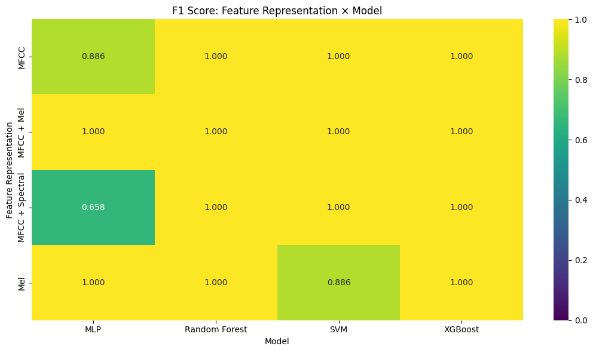
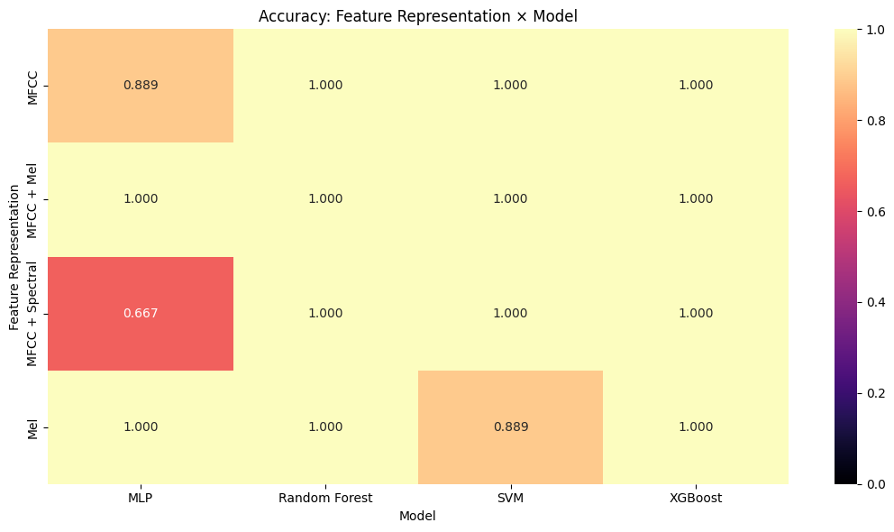
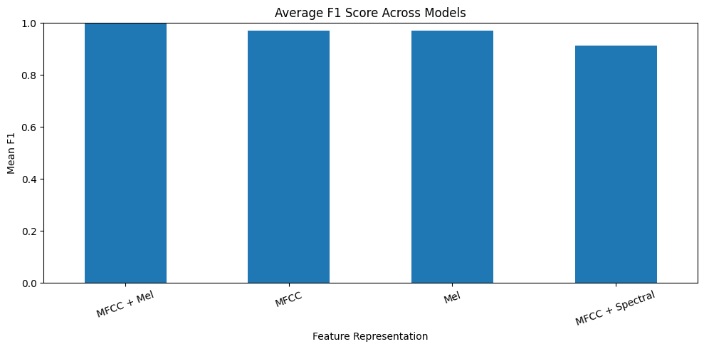
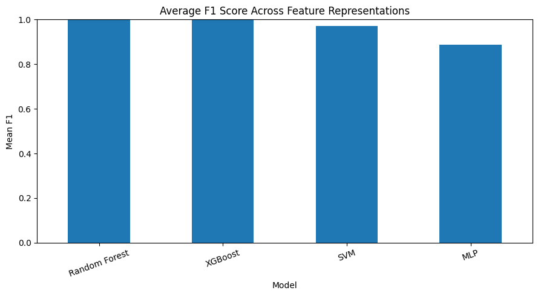
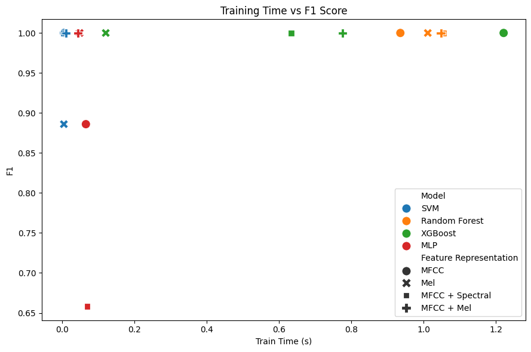
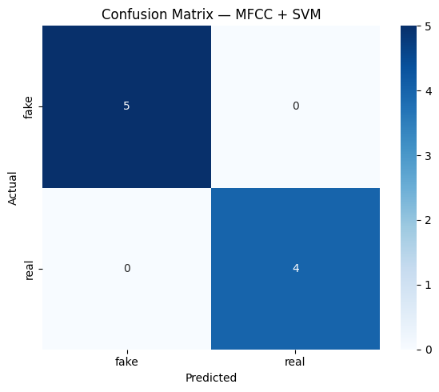
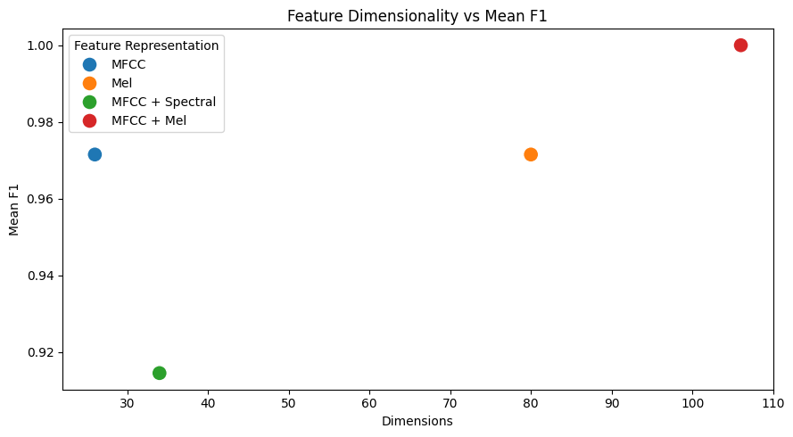

# Human vs. AI-Generated Voice Detection

A machine learning mini-project that classifies audio recordings as **human-generated (real)** or **AI-generated (fake)** using audio features and supervised learning models.

## Project overview

This project explores whether acoustic characteristics extracted from speech recordings can help distinguish real human voices from AI-generated voices. It compares several audio feature representations and machine learning classifiers, then evaluates their performance using a held-out test set and stratified cross-validation.

## Objectives

- Load and inspect a labelled speech-audio dataset.
- Extract MFCC, Mel-spectrogram, and spectral features.
- Compare different feature representations.
- Train and evaluate multiple machine learning classifiers.
- Compare test-set metrics, training/inference time, and cross-validation results.

## Dataset

The notebook downloads the **Speech Dataset of Human and AI Generated Voices** through KaggleHub:

- Dataset page: [Speech Dataset of Human and AI Generated Voices](https://www.kaggle.com/datasets/kambingbersayaphitam/speech-dataset-of-human-and-ai-generated-voices)
- Audio files found by the notebook: **42**
- Class distribution: **21 Real** and **21 Fake**
- Train/test split: **33 training files** and **9 test files**
- Split configuration: 80/20, stratified, with `random_state=42` (as configured in the notebook).

The audio dataset is downloaded at runtime by the notebook; it is not included in this repository.

## Methods

### Audio feature representations

The notebook evaluates four representations:

| Representation | Number of features |
|---|---:|
| MFCC | 26 |
| Mel | 80 |
| MFCC + Spectral | 34 |
| MFCC + Mel | 106 |

Audio is loaded/resampled at 16 kHz and processed using the feature-extraction configuration in the notebook.

### Machine learning models

- Support Vector Machine (SVM)
- Random Forest
- XGBoost
- Multi-Layer Perceptron (MLP)

### Evaluation

The notebook reports:

- Accuracy
- Precision
- Recall
- F1-score
- ROC-AUC
- Training time
- Inference time
- Stratified 5-fold cross-validation metrics

## Results

### Best individual test-set experiment

The top-ranked experiment in the notebook's test results is **MFCC + SVM**:

| Metric | Result |
|---|---:|
| Accuracy | 1.0000 |
| Precision | 1.0000 |
| Recall | 1.0000 |
| F1-score | 1.0000 |
| ROC-AUC | 1.0000 |

The held-out test set contains only **9 recordings** (5 fake and 4 real). These perfect scores should therefore be interpreted cautiously and are not evidence of generalization to all speakers, recording conditions, or voice-generation systems.

### Average performance by feature representation

| Feature representation | Mean accuracy | Mean precision | Mean recall | Mean F1 |
|---|---:|---:|---:|---:|
| MFCC + Mel | 1.0000 | 1.0000 | 1.0000 | 1.0000 |
| MFCC | 0.9722 | 0.9769 | 0.9722 | 0.9715 |
| Mel | 0.9722 | 0.9769 | 0.9722 | 0.9715 |
| MFCC + Spectral | 0.9167 | 0.9167 | 0.9167 | 0.9145 |

These are the averages reported by the notebook across the tested models for each feature representation.

### Output visualizations

The following figures are extracted from the notebook's saved outputs.

#### F1-score comparison heatmap



#### Accuracy comparison heatmap



#### Average metrics by feature representation



#### Average metrics by model



#### Training time versus F1-score



#### Confusion matrix for the best individual experiment



#### Feature dimensions versus mean F1-score



## Key observations

- MFCC + Mel has the highest average F1-score in the notebook's test-result summary.
- MFCC + SVM is the best individual experiment according to the notebook's selected result row.
- Random Forest and XGBoost have the highest average test metrics in the model-level summary.
- Cross-validation results are also calculated in the notebook; inspect those results alongside the held-out test metrics when interpreting model performance.

## Repository structure

```text
Human-vs-AI-Voice-Detection/
├── ML_MiniProject.ipynb
├── README.md
├── requirements.txt
└── results/
    ├── f1_score_heatmap.png
    ├── accuracy_heatmap.png
    ├── feature_representation_metrics.png
    ├── model_comparison.png
    ├── training_time_vs_f1.png
    ├── best_model_confusion_matrix.png
    └── feature_dimensions_and_f1.png
```

## Installation

Clone the repository:

```bash
git clone https://github.com/<your-username>/<your-repository>.git
cd <your-repository>
```

Install dependencies:

```bash
pip install -r requirements.txt
```

The notebook uses KaggleHub to download the dataset. If KaggleHub requires authentication or dataset access configuration in your environment, complete that setup before running the notebook.

## Run the notebook

Launch Jupyter:

```bash
jupyter notebook
```

Open `ML_MiniProject.ipynb` and run the cells from top to bottom.

## Requirements

The notebook uses the following Python packages:

- numpy
- pandas
- matplotlib
- seaborn
- librosa
- soundfile
- scikit-learn
- xgboost
- tqdm
- kagglehub

## Limitations and future improvements

- The dataset inspected by this notebook contains only 42 audio files, so the evaluation sample is small.
- A larger, more diverse dataset is needed to test performance across speakers, microphones, languages, accents, and AI voice-generation systems.
- Consider speaker-independent and source-independent splits to reduce the risk of data leakage.
- Evaluate on an external dataset and report confidence intervals before making strong claims about real-world performance.
- Review class-wise metrics and cross-validation variability when selecting a final model.

## Conclusion

This mini-project implements an end-to-end workflow for human-versus-AI voice classification, from audio loading and feature extraction to model comparison and evaluation. In the current experiment, MFCC + SVM achieves a perfect score on the small held-out test set, while MFCC + Mel has the highest average F1-score across feature representations. Further testing on larger and more diverse datasets is necessary before drawing conclusions about real-world reliability.

## Author

Add your name, course, institution, and project details here.
